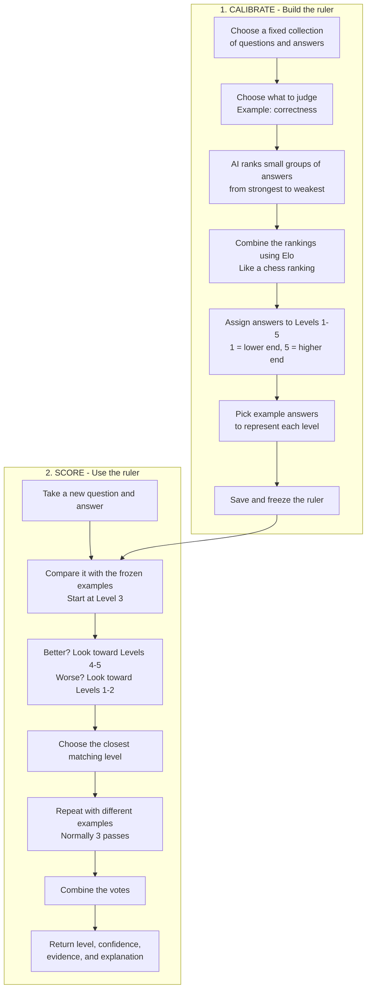
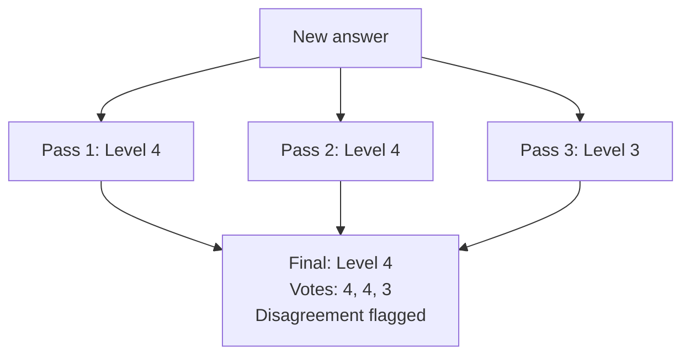

# Absolute Scoring

Think of calibrated absolute scoring as **building a grading ruler first, then
using that same ruler to grade new answers**, instead of asking the model to
invent a score each time.

## The whole flow

## 1. Calibration: What does each level look like?

We give the AI a fixed collection of answers. It compares them in small groups,
with each answer appearing multiple times.

Those rankings produce **Elo ratings**, like the ratings used to rank chess
players. These help order the answers. We then assign the answers to five levels
and select representative answers, called **exemplars**, from each level.

**We build a separate ruler for each criterion**, such as correctness or
completeness. A strong answer on one criterion is not automatically strong on
another.

Once saved, that ruler is frozen. New answers **do not change it**, and we do not
give those new answers Elo ratings.

Calibration must populate all five levels. If it cannot, it fails rather than
saving an incomplete ruler.

## 2. Scoring: Which example is this new answer closest to?

For each new answer, the AI receives examples from all five levels.

It starts with the middle example:

> Compared with the Level 3 example, is this answer better, similar, or worse?

Then it looks upward or downward and chooses the closest level. Each answer is
judged against **its own question**, not against whether it says the same thing
as the examples. For an equal tie between adjacent levels, the judge chooses the
lower level and marks the result as borderline.

Normally, we do this three times, using different representative examples from
each level, not three different grading scales:

- **Pass 1:** examples near the middle of each level (the 50th percentile).
- **Pass 2:** examples toward the stronger end of each level (the 75th percentile).
- **Pass 3:** examples toward the weaker end of each level (the 25th percentile).

These percentiles are **within each level**, not across the whole collection.
If a level contains very few answers, the same example can appear in more than
one pass. A one-pass mode is also supported and uses the middle examples.

### Example: Combining the votes

The majority wins. If all three votes differ, the middle voted level wins. For
example, votes of 2, 4, and 3 produce Level 3.

A pass can report **insufficient evidence** instead of forcing a score. The
system combines the usable votes and reduces confidence when fewer passes can
provide a score. If no pass has enough evidence, the final result is
**insufficient evidence**, with no assigned level.

## What do I get back?

For each answer and criterion, the result includes:

- **Level:** the selected grade from 1 to 5, when there is sufficient evidence.
- **Confidence:** the judge's reported confidence, adjusted for vote agreement
  and the number of usable passes.
- **Votes:** the levels selected by the usable passes.
- **Evidence and explanation:** why the answer fits that level.
- **Borderline status:** whether the selected judgment was borderline or the
  passes disagreed.

## The important limitation

**"Absolute" means the grading ruler stays fixed, not that the score is universal
truth.**

Level 5 means the higher end of **your calibration collection**. If that
collection contains only weak answers, Level 5 does not automatically mean
excellent in the real world.

Likewise, reported confidence is not a proven probability of correctness.
Review the exemplars and judgments, and use human-labeled examples when
validating whether the scale measures the quality you care about.

## Try it

- Follow the [calibration and scoring walkthrough](developing.md#calibrating-and-applying-an-absolute-answer-quality-scale)
  to create a ruler and score new answers.
- See the [AutoE CLI documentation](cli/autoe.md) for the `absolute-calibrate`
  and `absolute-score` commands.
- Use the [calibrated absolute baseline notebook](notebooks/calibrated_absolute_baseline.ipynb)
  to compare this method with direct one-shot grading.
- Read [Direct Absolute Baseline](evaluation/direct_absolute.md) to understand
  how direct grading differs from the frozen example-based scale.
- See [Evaluation Caches](cli/cache.md) for reusing completed judgments across
  interrupted runs.
