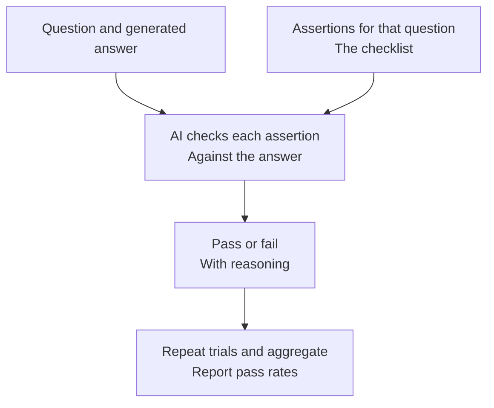

# Assertion-Based Scoring

Think of this as **running a checklist of requirements against an answer**.

An assertion is a statement or requirement that the answer should satisfy.
Instead of asking for an overall impression, we check those requirements
individually.

## How it works



Each individual judgment is binary: 1 for pass or 0 for fail. Repeated trials
help reveal variation in those judgments, and the scoring pipeline aggregates
the results using the configured pass threshold.

Assertions can be written by people or generated with AutoQ. They do not require
a complete reference answer.

## A simple example

For a question about a policy, the checklist might require:

1. State when the policy began.
2. Identify its main goal.
3. Mention a known limitation.

If the answer satisfies the first two but omits the third, two of the three
requirements pass. This gives a more specific diagnosis than a single overall
grade.

## What do I get back?

- Individual assertion judgments and explanations.
- Aggregated assertion and question-level results.
- Pass-rate summaries.

The CLI supports evaluating one RAG method or multiple methods against the same
assertions. Multi-method evaluation can also compare their results
statistically.

## When to use it

Use this method for factual requirements, coverage checks, and regression tests
where you can describe what a good answer must contain.

**Passing the checklist does not prove the entire answer is correct.** An answer
can satisfy every listed requirement and still include an untested error.
Generated assertions also need review: an incorrect requirement creates an
incorrect test.

For broad claims supported by more specific facts, see
[Hierarchical Assertion Scoring](hierarchical_assertion.md).

## Try it

```sh
benchmark-qed config init autoe_assertion ./local/assertion_test
benchmark-qed autoe assertion-scores \
  ./local/assertion_test/settings.yaml ./local/assertion_test/output
```

Configure the input paths and judge before scoring. See
[Assertion-Based Scoring Configuration](../cli/autoe.md#assertion-based-scoring-configuration)
and the [Assertion Generation notebook](../notebooks/assertion_gen.ipynb).
