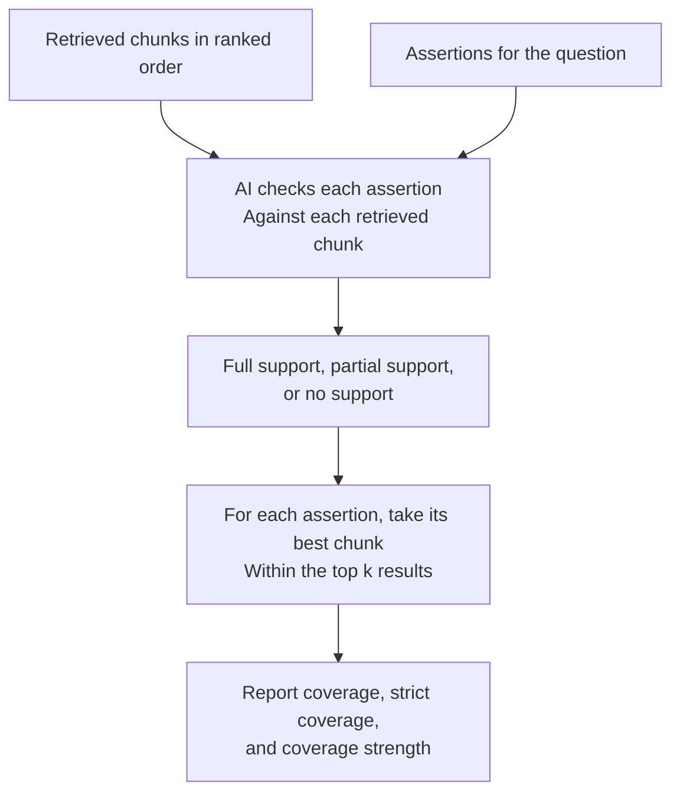

# Chunk Assertion Scoring

Think of this as **checking whether the retriever found the evidence needed to
answer the question**, before judging any final written answer.

The inputs are retrieved text chunks and per-question assertions, not generated
answers.

## How it works



Each assertion/chunk judgment has one of three grades:

| Grade | Score | Meaning |
|---|---|---|
| Full support | 1.0 | The chunk supports the assertion fully |
| Partial support | 0.5 | The chunk supports it partly |
| No support | 0.0 | The chunk does not support it |

For each assertion, the evaluator uses the **best single chunk** among the
results being considered. It reports results for configured values of `k`, such
as the top 5 or top 10 chunks, as well as all evaluated chunks.

## A simple example

An assertion requires the policy's start date:

- Chunk 1 discusses the policy but gives no date.
- Chunk 2 mentions only the decade.
- Chunk 3 gives the exact date.

The top two results might provide only partial support. Including the third
chunk can provide full support.

## What do I get back?

- **Coverage:** The fraction of scored assertions that meet the pass threshold,
  averaged across questions. At the default threshold, partial support counts.
- **Strict coverage:** The fraction with full support, averaged across questions.
- **Coverage strength:** The mean best-chunk score for scored assertions.
- Per-question metrics and judgment records for investigation.

## When to use it

Use this method to diagnose retrieval: whether the evidence appears at all, and
whether it appears early enough in the ranked results.

**It does not tell you whether the final answer used the evidence correctly.**
It also judges chunks individually; it does not combine several partial chunks
into one full-support judgment.

## Try it

Prepare a chunk-assertion configuration with retrieval records, assertions, and
the desired `k_list`, then run:

```sh
benchmark-qed autoe chunk-assertion-scores settings.yaml output
```

See the [AutoE CLI reference](../cli/autoe.md#cli-reference) for the command and
[Evaluation Caches](../cli/cache.md) for reusing assertion/chunk judgments.
