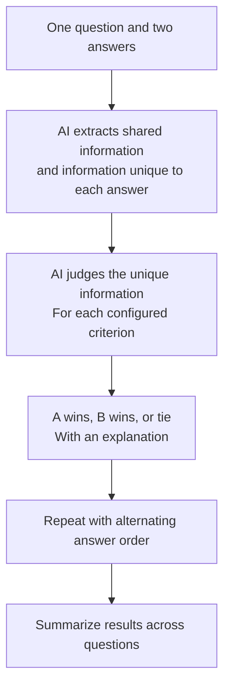

# Differential Pairwise Scoring

Think of this as **setting aside what two answers have in common, then judging
what each one adds**.

It is a two-stage alternative to [standard pairwise scoring](pairwise.md).

## How it works



The first stage separates the answers into:

- Information they share.
- Information found only in A.
- Information found only in B.

The second stage judges the unique information in the context of the question
and the shared information. It returns a verdict for each criterion. Trials
alternate the presentation order, just as in standard pairwise scoring.

## A simple example

Both answers correctly state when an event happened.

- **A adds:** a relevant explanation of why it happened.
- **B adds:** extra formatting and repeated background information.

The judge focuses on the value of those additions rather than treating more
text as automatically better.

## What do I get back?

- Shared and unique content extracted from the answers.
- Per-criterion winners and explanations.
- Pairwise score summaries across trials and questions.

Extraction and verdict judgments are cached separately. A completed extraction
can be reused if the verdict stage fails, or if compatible inputs are judged
again with different criteria.

## When to use it

Use this method when answers overlap heavily and you want to understand the
value of their differences.

**It aims to reduce length and formatting bias, not guarantee its removal.**
The extraction step can miss or misclassify information, and it adds another
model stage. Review the extracted differences as well as the final verdicts.

## Try it

```sh
benchmark-qed config init autoe_differential_pairwise ./local/differential_test
benchmark-qed autoe differential-pairwise-scores \
  ./local/differential_test/settings.yaml ./local/differential_test/output
```

Configure your inputs and judge before scoring. See
[Differential Pairwise Scoring CLI](../cli/autoe.md#differential-pairwise-scoring)
and [Evaluation Caches](../cli/cache.md).
