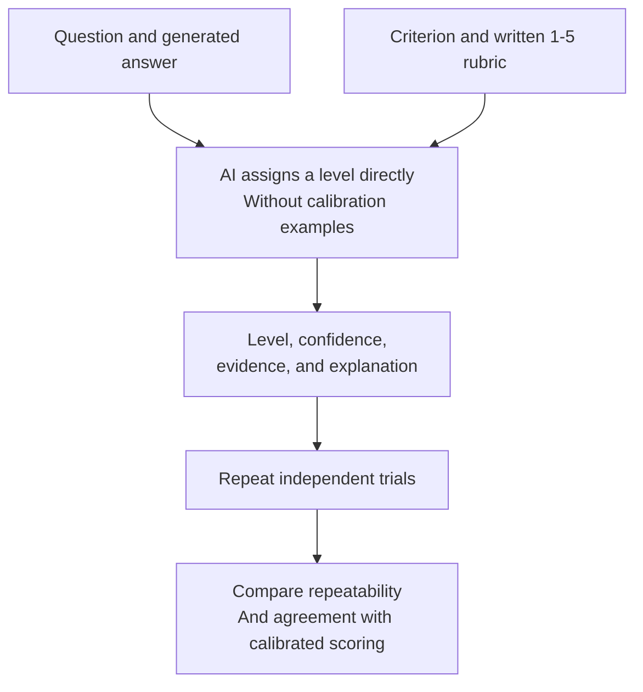

# Direct Absolute Baseline

Think of this as **asking the AI to grade an answer directly from a written
rubric**, without first showing it calibrated example answers.

This is a baseline for comparison with
[calibrated absolute scoring](../absolute_scoring.md). It is available through
the calibrated absolute baseline notebook and Python API, not a separate AutoE
CLI command.

## How it works

The rubric defines the levels in words:

| Level | Description |
|---|---|
| 1 | Very poor: severely fails the criterion |
| 2 | Poor: substantial weaknesses outweigh strengths |
| 3 | Adequate: meets the criterion with meaningful limitations |
| 4 | Good: meets the criterion well with only minor limitations |
| 5 | Excellent: exceptionally satisfies the criterion |

For each target answer and criterion, the judge assigns a level using this
rubric. Repeated trials make separate calls; they do not create or update an
Elo population.

## A simple example

Three direct judgments of the same answer might return Levels 3, 4, and 3.
That tells us something about the judge's repeatability.

If calibrated scoring returns Level 4, the notebook can also measure how much
the two methods agree. Those are different questions:

- **Repeatability:** Does one method give consistent results across trials?
- **Agreement:** Do the two methods assign similar levels?
- **Correctness:** Do those levels match a trusted human assessment?

Neither repeatability nor agreement establishes correctness on its own.

## When to use it

Use the direct baseline to investigate whether calibration changes results,
improves consistency, or introduces trade-offs in time and cost.

**The scales are not automatically interchangeable.** Direct grading uses verbal
quality descriptions; calibrated grading uses examples selected from a fixed
answer collection. A Level 4 from one method need not mean exactly the same thing
as a Level 4 from the other.

## Try it

Use the [Calibrated Absolute Baseline notebook](../notebooks/calibrated_absolute_baseline.ipynb)
to run repeated direct judgments and compare them with calibrated results.
