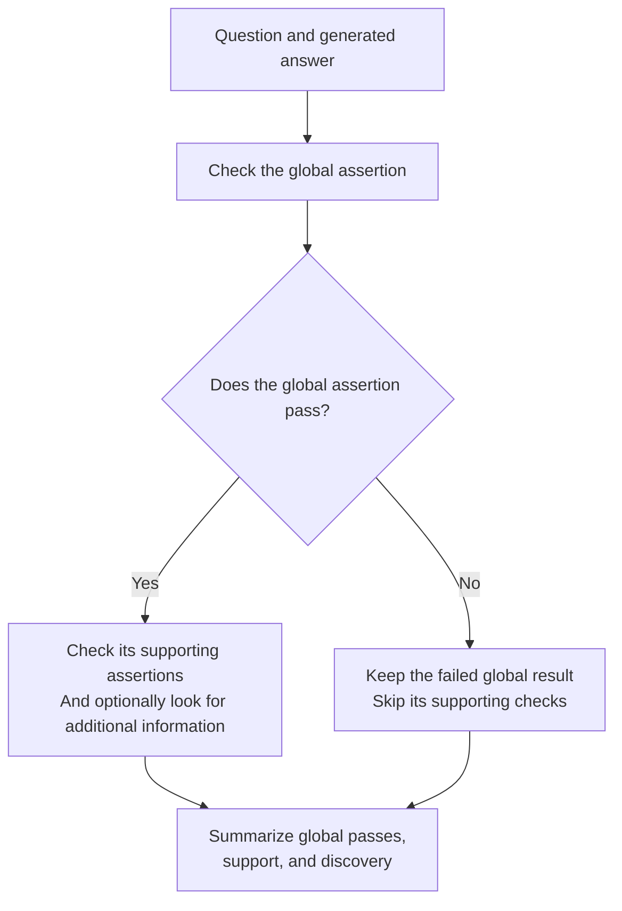

# Hierarchical Assertion Scoring

Think of this as **checking a headline claim and then checking the details that
support it**.

It extends [assertion-based scoring](assertion.md) with relationships between a
global assertion and supporting assertions.

## How it works

The default **staged** mode separates the broad judgment from the supporting
detail checks:



Two modes are available:

- **Staged:** Check global assertions first, then check supporting assertions
  for globals that passed. This avoids showing the supporting checklist during
  the initial global judgment.
- **Joint:** Check the global assertion and supporting details together in one
  call per judgment. This uses fewer stages, but the details may influence the
  global judgment.

## A simple example

**Global assertion:** The answer explains the policy's economic effects.

**Supporting assertions:**

- It describes the effect on employment.
- It describes the effect on prices.
- It describes the effect on investment.

An answer may satisfy the broad claim while covering only some supporting
details. Hierarchical scoring makes that difference visible.

## What do I get back?

- Global assertion pass results.
- Supporting assertion judgments and coverage measures.
- When enabled, discovery results for information beyond the supporting list.
- Aggregated summaries and optional comparisons across RAG methods.

An unsupported global pass is not accepted blindly: if it has no supporting
evidence and no detected discovery, the implementation overrides the global
score to fail.

## When to use it

Use this method for broad or global questions where a high-level conclusion
should be backed by multiple specific details.

**Discovery is a judge assessment, not independent fact verification.** Review
both the support hierarchy and any additional information the judge credits.
Joint mode's cheaper evaluation also comes with a risk of anchoring bias.

## Try it

Prepare a configuration with global and supporting assertions, then run:

```sh
benchmark-qed autoe hierarchical-assertion-scores settings.yaml output
```

See [Hierarchical Assertion Scoring Configuration](../cli/autoe.md#hierarchical-assertion-scoring-configuration)
for both modes and the single-method and multi-method input formats.
