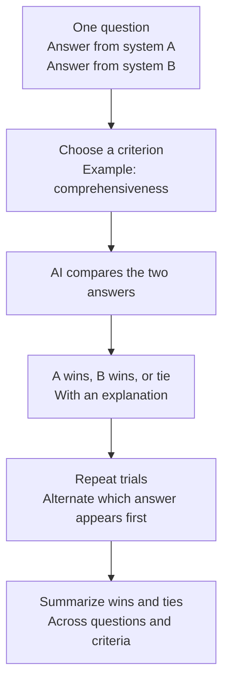

# Pairwise Scoring

Think of this as **putting two answers side by side and asking which one is
better**, rather than assigning either answer a standalone grade.

## How it works



Answers are matched by question ID. For each criterion, the judge compares the
two answers to that question and returns a winner or tie, with reasoning.

The presentation order alternates across trials to reduce the effect of an
answer always appearing first. Configuration requires an even number of trials
so both orders are used equally.

## A simple example

Suppose the question asks for three causes of an event:

- **System A** explains all three causes.
- **System B** explains only one cause.

On comprehensiveness, the judge may prefer A. On another criterion, the result
may differ, so criteria are scored separately.

A win counts as 1, a tie as 0.5, and a loss as 0 for the system being scored.
Across ten judgments, six wins, two ties, and two losses give a win rate of 0.7.

## What do I get back?

- Per-trial judgments, winners, and explanations.
- Win-rate summaries for each criterion.
- Statistical comparisons of the scored results.

## When to use it

Use pairwise scoring when you are choosing between systems or versions and do
not have reference answers.

**A win is relative to the opponent.** Beating a weak answer does not make an
answer excellent. The judge may also be influenced by length or presentation;
counterbalancing reduces order bias but does not eliminate every bias.

## Try it

```sh
benchmark-qed config init autoe_pairwise ./local/pairwise_test
benchmark-qed autoe pairwise-scores \
  ./local/pairwise_test/settings.yaml ./local/pairwise_test/output
```

Fill in the generated configuration and provide your answers before running the
scoring command. See [Pairwise Scoring Configuration](../cli/autoe.md#pairwise-scoring-configuration)
and the [AutoE notebook](../notebooks/autoe.ipynb).

If you want to focus the comparison on what each answer adds, see
[Differential Pairwise Scoring](differential_pairwise.md).
