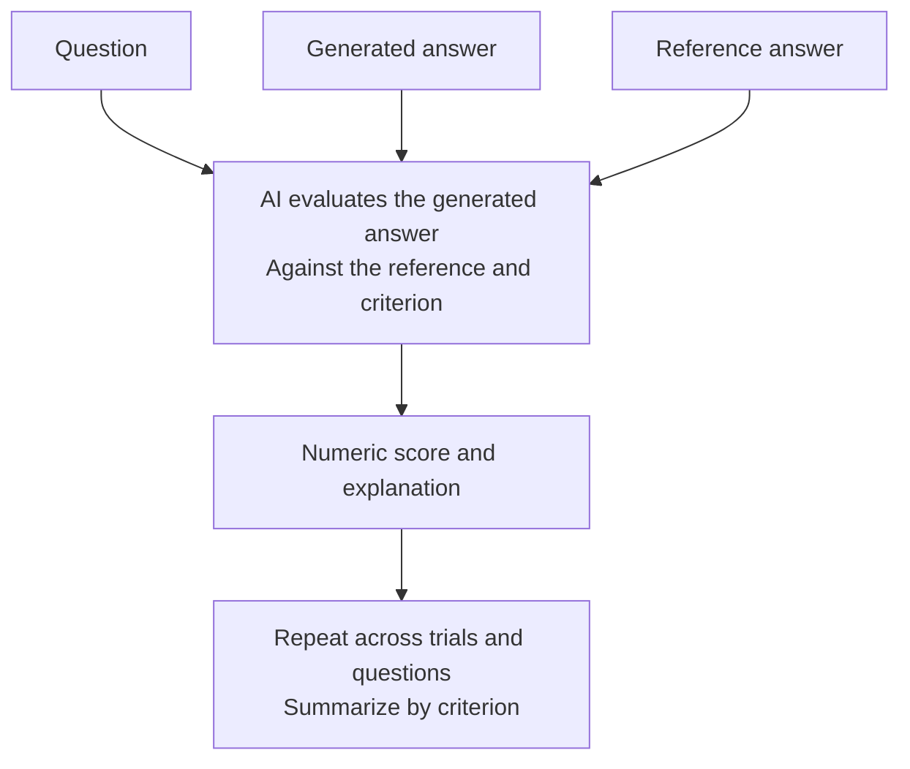

# Reference-Based Scoring

Think of this as **grading an answer with a trusted sample answer beside it**.

Unlike pairwise scoring, the reference is the comparison target, not another
system competing for a win.

## How it works



For each question, the judge receives the generated answer, the reference
answer, a criterion, and a scoring range. The default range is 1 to 10, and it
can be configured.

Criteria can ask different questions, such as:

- **Correctness:** Does the answer agree with the reference?
- **Completeness:** Does it cover the information expected by the reference?

The judge scores the meaning of the answer; this is not an exact text-match
test.

## A simple example

The reference says a policy began in 2020 and had two main goals.

An answer gives the correct date but describes only one goal. It may score well
on correctness but less well on completeness.

## What do I get back?

- Numeric scores and reasoning for each question, criterion, and trial.
- Summary statistics for each criterion.

## When to use it

Use this method when you have reliable reference answers and want to measure
how closely generated answers meet those expectations.

**The reference is part of the measuring tool.** If it is incomplete or wrong,
the evaluation can reward the wrong behavior. A valid alternative answer may
also contain useful information absent from the reference.

This differs from [calibrated absolute scoring](../absolute_scoring.md), which
compares quality with frozen examples from multiple levels rather than with a
reference answer for the same question.

## Try it

See [Reference-Based Scoring Configuration](../cli/autoe.md#reference-based-scoring-configuration)
to prepare the generated and reference inputs. With a completed configuration:

```sh
benchmark-qed autoe reference-scores settings.yaml output
```
