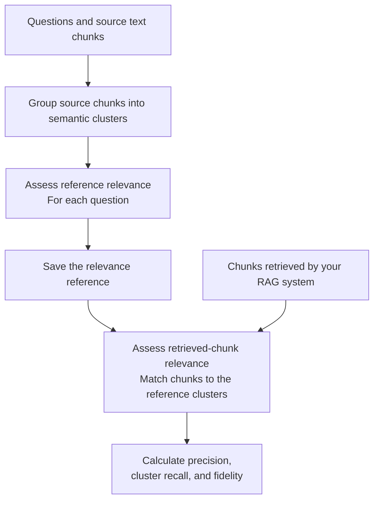

# Retrieval Metrics

Think of this as **checking whether a search found useful information and
covered the relevant parts of the collection**.

Unlike answer scoring, this evaluates retrieved chunks rather than the final
written answer. Unlike [chunk assertion scoring](chunk_assertion.md), it uses
relevance judgments and topic clusters rather than a checklist of required facts.

## How it works



There are two main stages:

1. **Generate a reference:** Organize source text into clusters and use a
   relevance judge to identify relevant material for the questions.
2. **Score retrieval results:** Judge the retrieved chunks and compare their
   cluster coverage and distribution with that reference.

## What do the metrics mean?

| Metric | In simple words |
|---|---|
| Precision | Of the chunks retrieved, how many were relevant? |
| Cluster recall | Of the relevant topic clusters in the reference, how many did relevant retrieved chunks reach? |
| Fidelity | How closely does the distribution of relevant retrieved chunks across clusters match the reference distribution? |

Fidelity uses a distribution distance, such as Jensen-Shannon distance or total
variation distance, and converts it to a similarity score. Higher fidelity
means a closer distribution match.

## A simple example

Suppose a question needs information from three relevant topic clusters:
employment, prices, and investment.

A retriever returns only relevant employment chunks:

- Its precision may be high.
- Its cluster recall is limited because it missed the other two clusters.
- Its fidelity may be low because the retrieved evidence is concentrated in
  one topic rather than distributed like the reference.

More chunks from the same topic do not automatically mean broader coverage.

## When to use it

Use these metrics to compare retrievers, retrieval budgets, or search strategies.

**The reference is an estimate, not unquestionable ground truth.** Results depend
on the source collection, clustering, sampled reference assessments, relevance
judge, and relevance threshold. Cluster recall is not exact document-level recall.

Chunk identity also matters. Use consistent text or IDs when matching retrieval
results to the reference, and investigate unmatched chunks.

## Try it

```sh
benchmark-qed autoe generate-retrieval-reference reference_settings.yaml
benchmark-qed autoe retrieval-scores retrieval_settings.yaml
```

See [Retrieval Metrics CLI Examples](../cli/retrieval_scores.md) for the input
formats and full workflow, and the
[Retrieval Metrics notebook](../notebooks/retrieval_metrics.ipynb) for an
interactive example.
